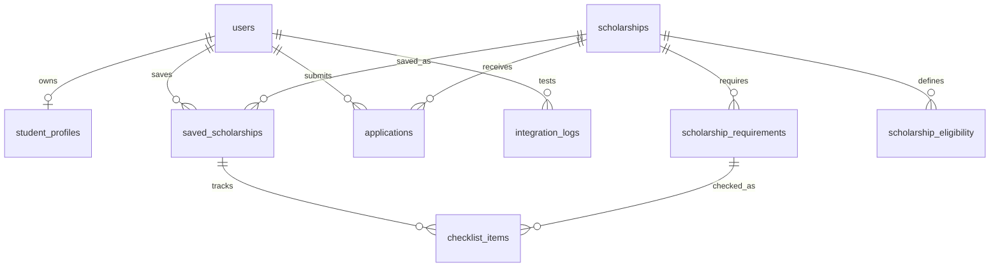

# Scholarship Hub — Group 15

ระบบใหม่สำหรับวิชา Platform Development: ค้นหาทุน บันทึกทุน ตรวจ GPA เบื้องต้น เตรียมเช็กลิสต์เอกสาร ส่งใบสมัคร และทดสอบ API ของ Team 03

**ข้อมูลทุนและผู้สมัครตัวอย่างเป็นข้อมูลสมมติ ระบบยังไม่ใช่ช่องทางสมัครทุนจริง**

## เริ่มจากศูนย์บนเครื่องของคุณ

1. ติดตั้ง Node.js รุ่นที่ตรงกับ `engines` ใน package.json (ชุดนี้ทดสอบด้วย Node 24), Git และ VS Code
2. แตก ZIP โค้ด เปิดโฟลเดอร์ที่มี `package.json` ผ่าน VS Code → File → Open Folder
3. เปิด Terminal → New Terminal แล้วรันทีละคำสั่ง:

```bash
npm install
npm run db:local
npm run dev
```

เปิด URL ที่ Terminal แสดง ปกติ `http://localhost:5173` การเตรียมฐานข้อมูลครั้งแรกจะ build และใช้ SQL ใน `drizzle/` กับฐานข้อมูลในเครื่อง หากเคยเตรียมแล้ว ไม่ต้องรัน `db:local` ทุกครั้ง

**การลงชื่อเข้าใช้ในเครื่อง:** starter จำลองบัญชีสำหรับ loopback development เท่านั้น กดลงชื่อเข้าใช้จากหน้าเว็บ จะเป็นบัญชีทดสอบ `local_seedy` ข้อมูลทดสอบในเครื่องแยกจากข้อมูลบน cloud และบัญชีจำลองไม่ถูกนำไปใช้ใน production

```bash
npm test
npm run typecheck
npm run build
```

หากใช้ pnpm ให้ใช้ `pnpm install` กับ `pnpm-lock.yaml` แทน ไม่ต้องผสม lockfile หลายตัวในทีม

## Happy Path สำหรับเดโม

1. เปิดเว็บออนไลน์และลงชื่อเข้าใช้ผ่านบัญชีที่มีสิทธิ์เข้า Site
2. ข้อมูลนักศึกษา → ใส่ข้อมูลสมมติ → บันทึกโปรไฟล์ (GPA 3.50)
3. ค้นหาทุน → ASEAN Scholarship Program → บันทึกทุน
4. เปิดรายละเอียด → ติ๊กเช็กลิสต์ 3 รายการที่เตรียมพร้อม
5. อ่านการใช้ข้อมูลและรับทราบ → ส่งใบสมัคร
6. ใบสมัครของฉัน → มีเลข `SCH-...` และสถานะส่งใบสมัครแล้ว
7. Refresh → ข้อมูลยังอยู่ในฐานข้อมูล
8. การเชื่อมต่อระบบ → ทดสอบเชื่อมต่อจริง → ตรวจ HTTP และ response → ดาวน์โหลดผล

เช็กลิสต์เป็นการระบุความพร้อมด้วยตนเอง **ไม่มีการอัปโหลดหรือการตรวจเอกสารจริง** สถานะส่งใบสมัครไม่ใช่การอนุมัติทุน

## เทคโนโลยีและความต่างจากเอกสารเก่า

- UI: React / TypeScript บน Vinext, CSS และ Lucide icons
- Backend: API routes รันบน Cloudflare Workers ผ่าน Sites
- ฐานข้อมูล: Cloudflare D1 / SQLite และ Drizzle migrations
- Identity: Sign in with ChatGPT จาก hosting platform ไม่มีตารางเก็บรหัสผ่าน
- Integration: fixed allowlisted URL ของ Team 03 จากเอกสารเดิม

เอกสารเก่าระบุ Supabase PostgreSQL ชุดนี้เป็น implementation ใหม่ ใช้ D1 เพื่อให้มีฐานข้อมูล cloud ที่ provision ได้ใน workflow นี้ **ไม่ได้เชื่อม ย้าย หรือนำข้อมูลจาก Supabase เก่ามาใช้** ต้องแก้เอกสารนำเสนอให้ตรง implementation ใหม่นี้

## โครงสร้างโค้ดที่ต้องอธิบายได้

| ไฟล์ | หน้าที่ |
|---|---|
| `app/scholarship-app.tsx` | หน้าเว็บ เมนู ฟอร์ม และการเรียก API |
| `app/globals.css` | สี รูปแบบ และ responsive layout |
| `app/page.tsx` | อ่าน identity ที่ platform ยืนยันแล้วและส่งให้ UI |
| `app/api/[...path]/route.ts` | รับ HTTP request ส่งต่อ service |
| `lib/service.mjs` | ตรวจเจ้าของข้อมูล CRUD การสมัคร และบันทึกผล integration |
| `lib/domain.mjs` | ตรวจ input, GPA, JSON/body size และ Origin |
| `lib/catalog.mjs` | ทุนสมมติ 4 ทุน / ข้อกำหนดเอกสาร |
| `lib/partner.mjs` | เรียก Team 03, timeout, ตรวจ response และตัดชื่อ/อีเมลออก |
| `db/schema.ts` | schema 10 ตาราง |
| `drizzle/` | SQL schema migrations |
| `tests/api.test.mjs` | automated tests ใช้ service จริงกับ SQLite ในหน่วยความจำ |
| `worker/index.ts` | worker entrypoint และ security headers |

## ฐานข้อมูล

คงแนวคิด 7 ตารางจากเอกสาร: users, student_profiles, scholarships, scholarship_requirements, scholarship_eligibility, saved_scholarships, checklist_items

ปรับ student_profiles เป็น 1:1 กับ users และไม่เก็บ password เพิ่ม applications, integration_logs และ rate_limits เพื่อรองรับ flow ใหม่



## GitHub: ทำอย่างไรเมื่อมีโค้ดแล้ว

สร้าง repository ว่างในบัญชี GitHub ของทีม ไม่ต้องเพิ่ม README จากเว็บ เพราะมีในชุดนี้แล้ว จาก Terminal ในโฟลเดอร์โค้ด:

```bash
git init
git add .
git commit -m "Add working scholarship platform with API and tests"
git branch -M main
git remote add origin https://github.com/YOUR_ACCOUNT/YOUR_REPOSITORY.git
git push -u origin main
```

แทน `YOUR_ACCOUNT/YOUR_REPOSITORY` ด้วย repository จริง ถ้ามี `.git` หรือ origin อยู่แล้วให้ใช้ `git status` และ `git remote -v` ตรวจของเดิมก่อน ห้ามทับ remote ที่ต้องเก็บไว้

Git อาจให้ลงชื่อเข้าใช้ผ่าน browser/credential manager ห้ามส่ง password/token ในแชท โค้ดชุดนี้ยังไม่ได้ push เข้า GitHub ของทีมโดยอัตโนมัติ

สมาชิกแต่ละคนควรแก้ส่วนที่ตนรับผิดชอบ ทดสอบ และ commit ด้วยบัญชีจริงของตน ไม่สร้างประวัติการมีส่วนร่วมย้อนหลัง

## Cloud deployment และสิทธิ์เข้าถึง

`.openai/hosting.json` ผูก Site ที่สร้างในรอบนี้ พร้อม binding DB และ source ที่ deploy จริง Sites จะ provision D1 และ apply migrations ตอน publish

Site ใหม่เริ่มเป็นส่วนตัว ลิงก์ที่ออนไลน์แล้ว **ไม่ได้หมายความว่าอาจารย์และเพื่อนทุกคนเข้าถึงได้** ต้องกำหนด audience/สิทธิ์ก่อนประเมิน และทดลองจากบัญชีของผู้ประเมินจริง

หากย้ายไป Cloudflare/Vercel/hosting ของทีม ต้องตั้งค่า deploy และระบบยืนยันตัวตนของปลายทางให้ครบ **ห้ามรับ header `oai-authenticated-user-id` จาก client ทั่วไปเป็นหลักฐานยืนยันตัวตน** header นี้เชื่อถือได้เฉพาะเมื่อมาจาก dispatch ที่ platform ควบคุม การ deploy Worker นี้แบบเปลือย ๆ โดยไม่มีชั้น authentication ไม่ถือว่าปลอดภัย

ถ้าแก้ข้อความเล็กน้อย เช่นคำโปรยใน `app/scholarship-app.tsx`: แก้ → `npm test` → `npm run typecheck` → `npm run build` → commit/push → publish เวอร์ชันใหม่ แล้วตรวจลิงก์ออนไลน์

## สิ่งที่ยังต้องทำก่อนส่ง

- ทดสอบ Team 03 จาก production ให้ได้จริงและประสานให้คู่เชื่อมเปิดระบบระหว่างประเมิน
- push source ไป GitHub ของทีม
- ตรวจสิทธิ์เข้าชม Site ของอาจารย์และสมาชิก
- ให้สมาชิกทุกคนทดสอบ browser happy path ด้วยตนเอง
- เติมรายชื่อผู้รับผิดชอบและผล manual test จริงใน `docs/TEAM_AND_AI.md` และ `docs/TESTING.md`
- อัปเดต diagram, deployment URL และฐานข้อมูลในรายงานให้ตรง implementation
- ใช้ข้อมูลสมมติในการเดโม ก่อนใช้ข้อมูลจริงต้องกำหนดนโยบาย/ผู้รับผิดชอบและจัดการข้อกำหนดส่วนบุคคลให้ครบ

## เอกสารเพิ่มเติม

- [API และตัวอย่างคำขอ](docs/API.md)
- [สถาปัตยกรรมและการออกแบบ](docs/ARCHITECTURE.md)
- [Security และข้อมูลส่วนบุคคล](docs/SECURITY.md)
- [Testing และขอบเขตผลทดสอบ](docs/TESTING.md)
- [ทีมและการใช้ AI](docs/TEAM_AND_AI.md)
- [หลักฐานล่าสุด](docs/EVIDENCE.md)

## Team 03 ใช้ Bearer token

ระหว่างสร้างชุดนี้ endpoint ตอบ HTTP 401 และแจ้งว่าต้องใช้ Authorization แบบ Bearer ให้ขอ token ที่อนุญาตใช้จริงจาก Team 03 แล้วตั้งเป็น server-only runtime secret ชื่อ `ENROLLMENT_BEARER_TOKEN` บน hosting

ในเครื่อง สร้าง `.dev.vars` ที่ไม่ขึ้น Git:

```text
ENROLLMENT_BEARER_TOKEN="ใส่ token จริงเฉพาะในเครื่องของคุณ"
```

อย่าส่ง token ผ่านแชทหรือ commit ลง GitHub เมื่อยังไม่มี token ระบบทุนส่วนอื่นใช้ได้ แต่ยังไม่สามารถนับ cross-group integration ว่าสำเร็จ
