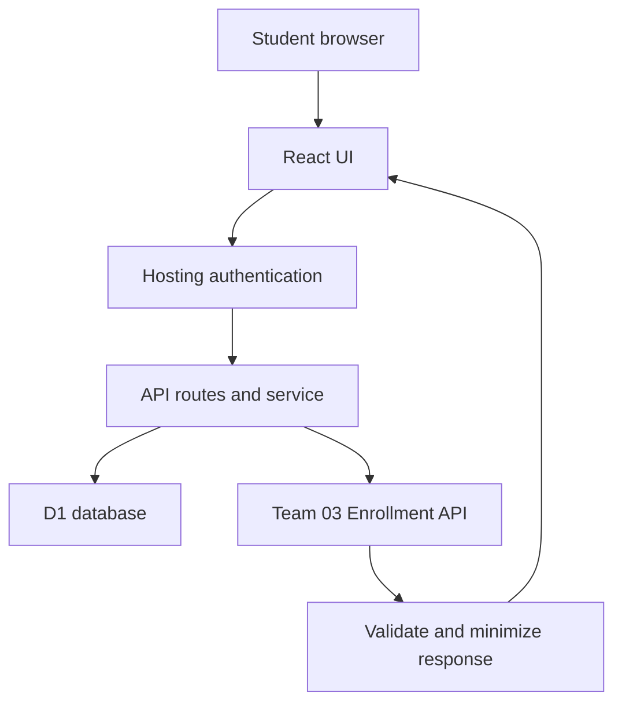

# Architecture

## Trust boundaries

1. Browser input is untrusted. Validation and record ownership live in `lib/service.mjs` / `lib/domain.mjs`, not only UI.
2. Identity headers must come from the trusted hosting layer. Self-hosting requires real authentication rather than trusting arbitrary inbound headers.
3. Partner API output is untrusted. Status and shape are checked; only bounded course fields return to the UI.
4. D1 queries use prepared bound parameters. User data is scoped by authenticated stable user ID.

## Data flow

Scholarship catalog is a fixed, explicitly fictional demonstration dataset in `lib/catalog.mjs`. A write creates its backing D1 catalog/requirements rows idempotently. Profiles, bookmarks, document check states, applications, and integration outcomes are persisted in D1.

Submitting an application requires profile, minimum GPA, open deadline, saved scholarship, completed checklist and acknowledgement of the privacy notice. A database unique index enforces one application per user/scholarship. The server returns the original record for a retry; no claim of Idempotency-Key header middleware is made.

Enrollment integration is shown as separate demonstration evidence. Student test ID 1 is not mapped to the current account and is never used to approve or reject that person's scholarship.

## Scope

No staff approval UI, file upload, payment/disbursement, webhook sender/receiver, background retry queue or automated award decisions. These features must not be claimed in the final presentation.
